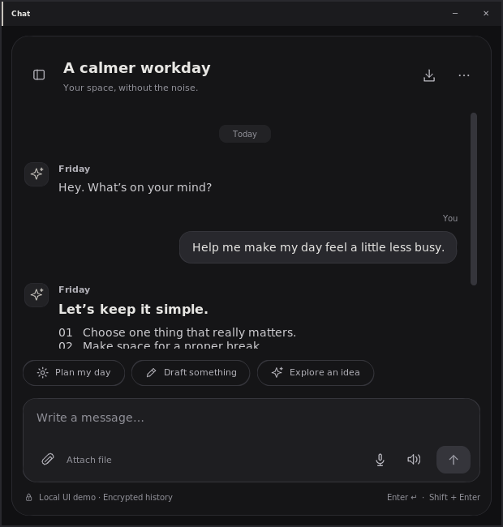

# Quiet Chat → Friday’s native Chat panel

The earlier Quiet Chat interface has been ported into Friday’s existing
`conversation_panels.ChatPanel` using **CustomTkinter**. This is an integration
inside Friday, not a replacement for the IDE and not a separate web app.


## What changed

- Original restrained charcoal/grey palette, rounded surfaces and antialiased
  line icons; branding now reads **Friday**.
- Conversation sidebar with New conversation, selected history and stable IDs.
- Scrollable transcript: right-aligned user bubbles and unboxed assistant text,
  headings, copy action and explicit sample-reply progress.
- Multiline composer, real placeholder overlay, enabled/disabled Send,
  **Enter** to send and **Shift+Enter** for a newline.
- Three prompt suggestions that fill, but do not automatically send, a draft.
- Per-conversation unsent text/file-name drafts survive switching conversations;
  the same view and draft survive Friday’s minimize/restore cycle.
- Filename-reference attachment chips, removal, export, confirmed deletion,
  information dialog, keyboard shortcuts and quiet notices.
- Below 850 logical pixels, history becomes an on-demand overlay rather than
  squeezing the composer. Extra prompts/keyboard hints reduce at narrow widths.
- Conversation UI history persists through Friday’s existing encrypted memory
  **kv** store under `chat_panel_ui:v1`. It does not use Quiet’s plaintext
  `~/.quiet_chat/conversations.json`, call embeddings or log demo exchanges as
  real semantic AI conversations.
- Unreadable/corrupt encrypted history is kept untouched; Chat starts a clearly
  labelled temporary session instead of replacing it. Save errors keep the
  conversation in memory and display **Session only**.



## Friday contracts retained

`ChatPanel` remains a native `tk.Toplevel` with the existing constructor:

```python
ChatPanel(master, on_minimize, on_close, corner_index=0,
          initial_content=None, bounds=None)
```

The shared Friday titlebar, drag/minimize/close controls, panel-manager
registration, explicit bounds, active-panel border/status and actual
**minimize-to-pill/restore** lifecycle are retained. An `initial_content` value
fills an unsent draft; it does not trigger a reply. The geometry methods used
by the manager (`maximize_to`, `move_to_slot`, `restore_default`) are implemented.

`panel_ui.build_titlebar` has one backwards-compatible optional `button_class`
argument. Only Chat supplies its timer-owning CTkButton subclass; all other
panels keep the original default buttons and unchanged appearance/behaviour.

The earlier standalone Quiet Chat and Quiet IDE projects are unchanged.
Friday’s embedded IDE `ChatSidePanel`, circle, tools and provider dispatch are
also unchanged. Profile/Image/Video panel classes retain their original source.

## Honest scope: UI integration, not a new AI backend

The native Chat panel was already a local demo before this integration. It
still uses **simulated sample replies** and identifies that clearly in its
header/footer and About dialog. It is not the circle’s typed command surface
or the IDE’s model-connected chat.

- No model/service is connected by this change.
- Mic and speaker controls remain visible, but explain that their backends
  are not connected; they never pretend to record or speak.
- Attachments contain **filenames only**. The picker does not read or upload
  file contents, and sample replies explicitly say this.
- UI history is encrypted using Friday’s existing local key/storage system.
  Explicit **Export conversation** produces a plaintext `.txt` at the
  location the user chooses; Copy uses the system clipboard.
- Drafts are in-memory per view, like the earlier Quiet Chat app. They survive
  minimize/restore and conversation switching, not a process restart.
- If a panel is closed mid-reply, its user message remains saved; the detached
  sample worker cannot mutate a closed view or resurrect a deleted chat.

`ChatView` keeps the original optional `reply_handler(text, history) -> str`
extension point. It executes on a background thread and must not access Tk;
results arrive through an owner-thread queue. A live Friday connection needs
separate work to bridge its existing Qt workers, tool/permission flows,
cancellation and conversation policy—not a silent network call from this UI.

## Files

| File | Responsibility |
|---|---|
| `conversation_panels.py` | Thin native ChatPanel host; other panels remain separate |
| `friday_chat/view.py` | Adapted original Quiet Chat child interface |
| `friday_chat/model.py` | Conversation/message data, validated state and honest sample replies |
| `friday_chat/storage.py` | Friday-encrypted UI history adapter |
| `friday_chat/icons.py` | Pillow line icons; per-view, explicit-interpreter CTkImage ownership |
| `friday_chat/widgets.py` | Panel-scoped scrolling and timer-owning CTk widgets |
| `panel_ui.py` | Existing shared chrome with optional button class |

### Tk ownership and lifecycle

Friday has separate Tk owners for its IDE and native work panels. The earlier
standalone app’s global CTkImage cache and implicit-root CTkFonts cannot be
copied directly into that architecture. The port uses:

- per-view CTkImages whose `ImageTk.PhotoImage` explicitly uses the owning view;
- pure Pillow rasters as the only shared icon cache;
- font tuples and text measurement through the view’s own Tcl interpreter;
- Toplevel-scoped wheel/Shift/keyboard bindings removed by ID, not `bind_all`
  overrides that affect another panel;
- cancelled composer scrollbar checks, button animations, tooltips, dialogs,
  queue polling, notices and resize/scroll timers on close;
- the CTk DPI timer on the persistent owner-thread Tk host rather than a
  short-lived Chat Toplevel; dead Chat scaling entries are released;
- background reply closures retaining plain data/queue, never the view.

CustomTkinter is constrained to the tested 5.x API (`>=5.2.2,<6`); Pillow is
now an explicit dependency rather than an implicit/transitive one.

## Run and test

Launch Friday through its usual setup/entry point in the main README and open
its **Chat** work panel (`open_app(name="chat")` via Friday’s existing tools).
There is no replacement app entry point or change to the IDE chat.

Targeted tests need Tk, CustomTkinter, Pillow, NumPy and cryptography, not
provider API keys:

```bash
python -m unittest discover -s dev_tests -p test_friday_chat_model.py -v
# With a display on Windows/macOS, omit xvfb-run:
xvfb-run -a python -m unittest discover -s dev_tests -p test_friday_chat_gui.py -v
xvfb-run -a python dev_tests/test_friday_chat_integration.py
xvfb-run -a python dev_tests/test_conversation_panels.py
```

The integration test deliberately leaves another Tk interpreter as the
default root, opens Chat on the actual AppPanelManager GUI thread and tests
real pill restore, status/bounds, reopen and mid-reply close.

See [verification results](QUIET_CHAT_VERIFICATION.md) for the tested environment,
actual suite results and remaining runtime limits. Both screenshots are
captures of the real native panel—not generated images or browser mockups.
